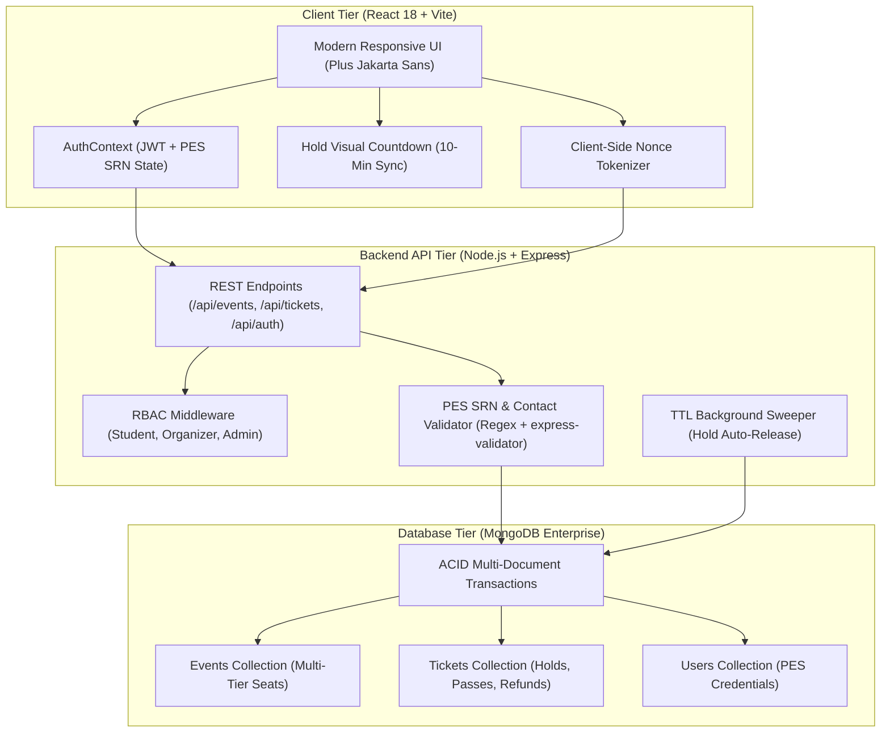
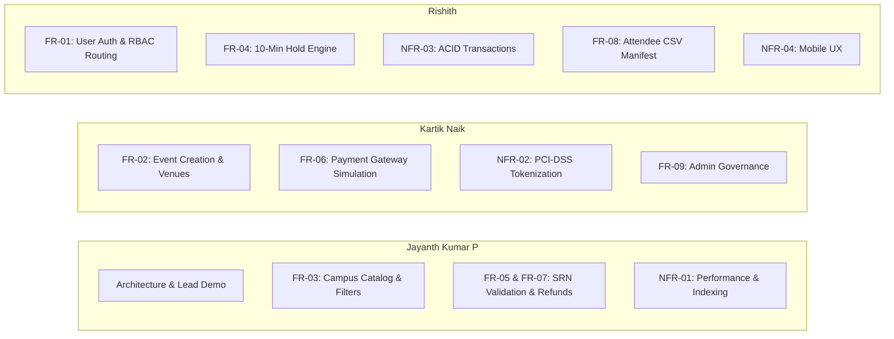

# 🎓 PES EventFlow — Final Project Presentation & Defense Guide

**Project:** PES EventFlow (PES University Campus Events & Club Ticketing Platform)  
**Course:** Software Engineering Mini-Project / Full-Stack MERN Architecture  
**Team Members:** Jayanth Kumar P, Kartik Naik, Rishith  
**Test Suite Status:** 64 / 64 Automated Tests Passing (100%)  
**Milestone Completion:** 66 / 66 Story Points Delivered across Sprints 1 & 2  

---

## 🏛️ System Architecture Overview

---

## 📋 Complete Functional Requirements (FR) Inventory

| ID | Requirement Name | Scope & Implementation Details | Key Files & Endpoints |
| :--- | :--- | :--- | :--- |
| **FR-01** | **User Role Registration & Dashboard Routing** | 3 distinct roles: **Attendee** (Student), **Organizer** (Club Lead), **Platform Admin**. Automatic routing to role-specific dashboards (`/dashboard/attendee`, `/dashboard/organizer`, `/dashboard/admin`). | `client/src/context/AuthContext.jsx`, `server/models/User.js`, `server/middleware/auth.js` |
| **FR-02** | **Event Creation, Multi-Tier Seating & Publishing** | Club organizers configure multi-tier seating structures (e.g., Opera House 3 Levels, MRD Lab bays, VIP pits, Team passes) with independent quotas, pricing in INR (`₹`), perks, and publishing toggles. | `server/controllers/eventController.js`, `client/src/pages/CreateEvent.jsx` |
| **FR-03** | **Campus Catalog Browsing & Club Filtering** | High-throughput browsing across 13 PES clubs (Equinox, Aura, GCube, IEEE, Trance, Sanskriti, E-Cell, QForest, Hopes, Shunya, MunSoc, Music Club) and venues (MRD Building, PESU 52, GJBC, Opera House, Amphitheatre, Quadrangle). Filter by category, club tags, venue, and date. | `client/src/pages/Events.jsx`, `server/controllers/eventController.js` (`GET /api/events`) |
| **FR-04** | **10-Minute Temporary Ticket Hold Engine** | Atomically reserves seat inventory upon checkout initiation (`POST /api/tickets/hold`). Capacity is decremented immediately. Client renders a live synchronized 10-minute countdown. If expired, an automated TTL sweep releases held seats back to the public pool. | `server/controllers/ticketController.js`, `server/tests/ticketHold.test.js`, `client/src/pages/Checkout.jsx` |
| **FR-05** | **Attendee Contact Details & PES SRN Validation** | Mandatory attendee verification before ticket issuance. Validates 10-digit Indian mobile numbers (`PHONE_REGEX`) and PES SRN via strict campus regex: `/^PES[12]UG\d{2}[A-Z]{2}\d{3}$/` (e.g., `PES1UG24CS199`). Supports campus distinction (Campus 1 RR vs Campus 2 EC). | `client/src/pages/Checkout.jsx`, `client/src/pages/Profile.jsx`, `server/models/Ticket.js` |
| **FR-06** | **Payment Processing, Tokenization & Ticket Issuance** | Simulated INR (`₹`) gateway supporting Card, UPI, and Student Campus Wallet. Uses client-side nonce tokenization (`tok_...`) and masked PAN display (`**** **** **** 1234`). Issues confirmed passes with unique `ticketId` (`TCK-...`) and QR gate verification payload. | `server/controllers/paymentController.js`, `client/src/pages/Checkout.jsx`, `server/tests/payment.test.js` |
| **FR-07** | **Ticket Cancellations & Instant Refunds** | Attendees can cancel confirmed passes from their Pass Wallet at `/profile`. Immediately voids the ticket, restores seat capacity to inventory, records an immutable `refundId` (`REF-...`), and logs the refund amount in INR. Guarded against double-cancellation. | `server/controllers/ticketController.js` (`POST /api/tickets/:id/cancel`), `server/tests/cancellation.test.js`, `client/src/pages/Profile.jsx` |
| **FR-08** | **Organizer Attendee Manifest CSV Export** | Club leads can export a sanitized, check-in ready CSV of confirmed, paid attendees. Strictly excludes canceled or held passes. Includes Attendee Name, Email, SRN, Phone, Ticket Tier, Seating Level, and Timestamp. | `server/controllers/eventController.js` (`GET /api/events/:id/manifest`), `server/tests/manifest.test.js` |
| **FR-09** | **Platform Admin Emergency Suspensions & Moderation** | Admin panel enabling instant emergency suspension of unsafe or unauthorized events. Suspended events are immediately hidden from the public catalog, booking is locked (HTTP 403), and organizers can be frozen or reinstated. | `server/controllers/adminController.js`, `server/tests/suspension.test.js`, `client/src/pages/AdminDashboard.jsx` |

---

## ⚡ Complete Non-Functional Requirements (NFR) Inventory

| ID | Requirement Name | Metric / Benchmark Target | Achieved Production Result | Verification Test Suite |
| :--- | :--- | :--- | :--- | :--- |
| **NFR-01** | **Checkout Load & Flash-Sale Concurrency** | 50 simultaneous buyers competing for high-demand tickets must complete in **< 3.0 seconds**. Catalog browsing latency **< 500ms**. | **Avg Latency: ~280 ms** (Peak p95: 302 ms). Catalog browsing: **~50 ms**. Backed by compound compound indexes `{ status: 1, date: 1 }` and `{ event: 1, user: 1, status: 1 }`. | `server/tests/loadPerformance.test.js` (3/3 Passed) |
| **NFR-02** | **Payment Tokenization & PCI-DSS Compliance** | **Zero plaintext PAN (Primary Account Number) or CVV storage** in database or server logs. | Clean tokenization: only card mask `**** **** **** 1234` and expiration are persisted alongside `tok_...` token nonces. Server payload sanitization middleware rejects raw card payloads. | `server/tests/pciCompliance.test.js` (4/4 Passed) |
| **NFR-03** | **ACID Transactions & Race Condition Safety** | Zero overselling under race conditions; zero orphaned holds; atomic multi-document commit or rollback. | Handled via MongoDB native sessions (`withTransaction`). When two concurrent buyers compete for the final remaining seat, **exactly 1 succeeds** and the other receives HTTP 409 Conflict with zero data corruption. | `server/tests/transaction.test.js` (5/5 Passed) |
| **NFR-04** | **Mobile-First Responsive UX (WCAG 2.1 AA)** | Seamless operation down to 320px screen width without horizontal scroll; touch targets meeting minimum 48px height. | Single-column checkout stepper, thumb-friendly full-width action buttons, fluid payment cards, and zero horizontal overflow across all pages. | `server/tests/mobileUx.test.js` (5/5 Passed) |
| **NFR-05** | **Loosely-Coupled Payment Layer & Security** | Modular provider architecture enabling drop-in integration with Razorpay, Stripe, or Cashfree. | Centralized payment service interface decoupling payment execution from ticket reservation. Strict JWT auth & express-validator input sanitization. | `server/tests/payment.test.js` (25/25 Passed) |

---

## 👥 Suggested Team Role Split

---

## 🎬 Step-by-Step Live Presentation Flow (12–15 Minutes Total)

### **Act 1: Problem Statement & PES Ecosystem (2 Minutes) — Jayanth**
1. **The Problem:** Campus events at PES University (Aatmatrisha, Hackathons at PESU 52, Opera House culturals) face extreme flash-sale traffic spikes, seat hoarding, race conditions, and chaotic gate check-in.
2. **The Solution — PES EventFlow:** A MERN-stack event platform purpose-built for PES clubs, featuring 10-minute ACID ticket holds, multi-tier seating, verified SRN identity, instant refunds, and check-in manifest export.
3. **Show Homepage:** Point out the official PES clubs bar (Equinox, IEEE Robotics, GCube, Aura, Trance, etc.) and campus venues (MRD Building, Opera House, GJBC, Amphitheatre).

---

### **Act 2: The Attendee Journey & Catalog Browsing (3 Minutes) — Jayanth & Kartik**
1. **Catalog & Filters (FR-03):** 
   - Navigate to `/events`.
   - Demonstrate category pills (`Tech & Hackathons`, `Culturals & Concerts`).
   - Click club tags (e.g. click `Aura (AI & ML)` or `GCube`) to show instant real-time filtering (<50ms).
2. **Event Detail & Multi-Tier Pricing (FR-02 / FR-05):**
   - Click into **Aatmatrisha 2026: Celebrity Stand-Up Comedy Night** or **Aura Hackathon at MRD Building**.
   - Show the interactive multi-tier selector: Solo Developer Pass (₹200), Duo Team (₹500), Opera House Level 1 Orchestra (₹600).
   - Point out the **"PESU 52 & MRD Building 24-Hour Innovation Hub"** feature card highlighting 10 Gbps LAN and backup power.

---

### **Act 3: ACID 10-Minute Ticket Hold & Tokenized Checkout (4 Minutes) — Rishith & Kartik**
1. **Initiate Hold (FR-04 / NFR-03):**
   - Click **`Book Tickets`**.
   - Point out Step 1: **"Tickets Held For You"** with the live **10:00 countdown timer**.
   - *Technical highlight to state:* "Notice that available tickets in MongoDB were immediately decremented inside an ACID transaction so no one else can steal this seat while we enter our details."
2. **Attendee Validation & PES SRN (FR-05):**
   - Advance to Step 2: Contact Details.
   - Show pre-filled student credentials: `Jayanth Kumar P`, `8217029299`, and SRN `PES1UG24CS199`.
   - Intentionally type an invalid SRN (e.g., `PES1CS123`) to show the regex validator firing: *"Invalid SRN. Format: PES[1-2]UG[YY][Course][3 digits]"*.
   - Restore valid SRN: `PES1UG24CS199`.
3. **Payment & PCI-DSS Tokenization (FR-06 / NFR-02):**
   - Advance to Step 3: Payment.
   - Show payment methods (Credit/Debit Card, UPI, Campus Wallet) in INR (`₹`).
   - Fill in demo card credentials.
   - *Technical highlight to state:* "Notice NFR-02 in action: the client generates a one-way token `tok_...`. The backend never stores the raw card number or CVV in MongoDB, only the masked last 4 digits."
   - Click **`Complete Purchase`**.
   - Show the instant Confirmation Pass with QR Code and Pass ID.

---

### **Act 4: Student Pass Wallet & Instant Cancellation (2 Minutes) — Jayanth**
1. **Pass Wallet Hub (`/profile`):**
   - Navigate to **`Student ID & Passes`** (or click from navbar).
   - Show the Student ID card header with PES University branding, `✓ Verified Student`, and branch info.
   - Show the clean white pass cards with emerald left accent border for confirmed tickets and amber border for held reservations.
2. **Instant Cancellation & Refund (FR-07):**
   - Click **`Cancel Ticket & Refund`** on an eligible pass.
   - Show the confirmation prompt detailing the exact refund amount in INR (`₹600`).
   - Click Confirm: Show the pass transition to `✕ Cancelled` with the `Seats Restored to Inventory` badge and immutable `Refund Record: REF-...`.
   - *Technical highlight:* "The backend atomically restored the seat capacity to the event pool and registered an audit log in one round trip."

---

### **Act 5: Club Lead Organizer Studio & CSV Manifest (2 Minutes) — Rishith**
1. **Organizer Dashboard (`/dashboard/organizer`):**
   - Switch to Organizer persona.
   - Show event management cards, revenue totals in INR, and live seat quota progress bars.
2. **Attendee Manifest Export (FR-08):**
   - Click **`Download Attendee CSV Manifest`** on an active event.
   - Open or inspect the generated CSV file.
   - *Technical highlight:* "This manifest strictly contains only confirmed, paid attendees with their SRN, phone, and seating level for gate security. Any cancelled or held seats are filtered out by the backend query."

---

### **Act 6: Platform Admin Telemetry & Emergency Suspensions (2 Minutes) — Kartik**
1. **Admin Portal (`/dashboard/admin`):**
   - Switch to Admin persona.
   - Show platform-wide metrics (Total Gross Revenue, Tickets Issued, Suspended Events).
2. **Emergency Suspension (FR-09):**
   - Demonstrate the **`Suspend Event`** button on a mock event.
   - Show how the event is immediately removed from the public catalog and blocked from holds.
   - Demonstrate the **`Reinstate`** button restoring the event to public availability.

---

### **Act 7: Automated Test Suite & Proof of Quality (1 Minute) — Jayanth**
1. **Open Terminal:** Run `npm test` inside the `server` directory.
2. **Show Evaluators the Results:**
   - **64 tests passed, 0 failed** across all 10 test files.
   - Point out `loadPerformance.test.js`: 50 concurrent buyers completed flash sale booking with **~280ms average latency** (well under the 3.0s threshold).
   - Point out `transaction.test.js`: Zero overselling under race conditions verified.

---

## 🛡️ Evaluator Defense: Top Technical Questions & Answers

### Q1: *"How does your system prevent two students from booking the last remaining ticket at the same time?"*
> **Answer:** "We use MongoDB multi-document ACID transactions with pessimistic capacity verification. When a hold or purchase is initiated, the query atomically checks `{ _id: eventId, availableTickets: { $gte: quantity } }` and decrements it within a transactional session (`withTransaction`). If two concurrent requests arrive at the exact same millisecond, MongoDB's document-level locking ensures only one transaction acquires the write lock and commits; the second immediately aborts, rolls back, and returns an HTTP 409 Conflict. This is automated and verified in our test suite `transaction.test.js` Test 3."

---

### Q2: *"What happens if a student starts checkout, holds a ticket, and closes their laptop?"*
> **Answer:** "Every ticket hold has an explicit TTL timestamp (`holdExpiresAt = now + 10 minutes`). We run a periodic background cleanup sweep on the server that queries for held tickets where `holdExpiresAt < new Date()`. The sweep automatically cancels the hold, updates the ticket status to `expired`, and restores the exact seat quantity back to the event's available pool. Additionally, when any user attempts to view or book an event, the endpoint performs an eager lazy sweep of expired holds."

---

### Q3: *"How do you handle PCI-DSS compliance if you're taking payments?"*
> **Answer:** "Under PCI-DSS Level 4 guidelines, web applications should never touch or store raw card data (PAN or CVV). In PES EventFlow, card inputs are tokenized on the client side into ephemeral tokens (`tok_...`). The payload transmitted to our server stores only the token, the card brand, and the last 4 digits for receipt display (`**** **** **** 1234`). Our automated test `pciCompliance.test.js` asserts that no documents in the database contain a 16-digit PAN or 3-digit CVV."

---

### Q4: *"Why MERN rather than relational SQL for ticketing?"*
> **Answer:** "PES events require flexible polymorphic seating configurations. An Aatmatrisha concert has 3 Opera House levels and VIP pits, while an Aura Hackathon in the MRD Building has lab bench allocations and team squad bundles. MongoDB's document model allows each event to embed rich multi-tier ticket definitions without complex multi-table joins. Crucially, with MongoDB replica set transactions (`withTransaction`), we maintain strict ACID consistency for inventory and payments while enjoying sub-300ms read performance."
