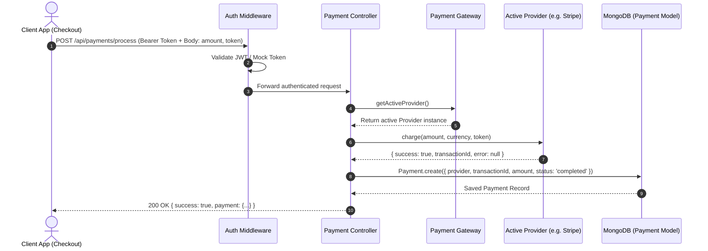
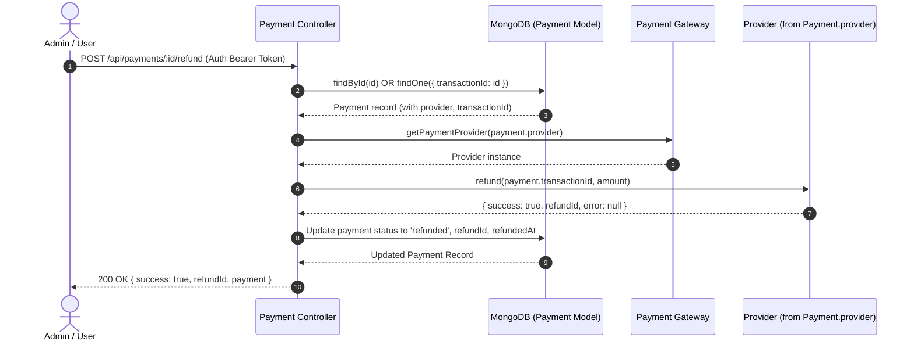

# Architecture Documentation: Loosely Coupled Payment API Layer (NFR-05)

## 1. Architectural Overview & Motivation

In an Event Management System, processing ticket purchases and issuing refunds are mission-critical workflows. However, tight coupling between core domain logic (ticket inventory, reservations, event quotas) and a specific third-party payment provider (such as Stripe, PayPal, or Square) introduces significant architectural liabilities:
- Changing payment vendors requires invasive code modifications throughout business controllers.
- Automated testing becomes difficult, brittle, or slow due to direct external network dependencies.
- Disparate provider error formats and request payloads leak into business and presentation layers.

**NFR-05** addresses these challenges by introducing a **Strategy Pattern** and a **Factory Pattern** abstraction layer. This layer encapsulates all payment gateway specifics behind a uniform, provider-agnostic interface. The core checkout and inventory subsystems depend solely on high-level abstractions, fulfilling the **Dependency Inversion Principle (SOLID)**.

---

## 2. Design Patterns Applied

### 2.1 Strategy Pattern
The Strategy Pattern defines a family of interchangeable algorithms and encapsulates each one inside a separate class.

- **Strategy Interface (`PaymentProvider`)**: An abstract base class in `server/services/paymentService.js` defining standard method signatures:
  - `charge(amount, currency, token)`: Captures payment using a tokenized payment source.
  - `refund(transactionId, amount)`: Initiates a refund for an existing charge.
  - `getName()`: Returns the string identifier of the provider.
- **Concrete Strategies**:
  - `StripeProvider` (`server/services/providers/stripeProvider.js`): Simulates tokenized Stripe charges, decline scenarios, and refund processing.
  - `MockProvider` (`server/services/providers/mockProvider.js`): Deterministic provider that always succeeds for rapid offline testing and continuous integration.

```
                    +-----------------------+
                    |   PaymentProvider     |
                    |   (Abstract Strategy) |
                    +-----------------------+
                    | + charge()            |
                    | + refund()            |
                    | + getName()           |
                    +-----------------------+
                               ^
                               |
             +-----------------+-----------------+
             |                                   |
  +---------------------+             +---------------------+
  |   StripeProvider    |             |    MockProvider     |
  +---------------------+             +---------------------+
  | + charge()          |             | + charge()          |
  | + refund()          |             | + refund()          |
  | + getName()         |             | + getName()         |
  +---------------------+             +---------------------+
```

### 2.2 Factory Pattern
The Gateway Factory (`server/services/paymentGateway.js`) dynamically instantiates the appropriate strategy:
- `getPaymentProvider(providerName)`: Instantiates a provider strategy given its registered name (e.g., `'stripe'`, `'mock'`).
- `getActiveProvider()`: Resolves the active provider by reading the `PAYMENT_PROVIDER` environment variable (defaults to `'mock'`).
- `registerProvider(name, providerClass)`: Enables open-ended extension at runtime.

---

## 3. Sequence Flow Diagrams

### 3.1 Payment Processing Flow (`POST /api/payments/process`)



### 3.2 Refund Flow (`POST /api/payments/:id/refund`)



### 3.3 Text / ASCII Sequence Diagram

```
[Client]
   │
   │ 1. POST /api/payments/process (token, amount, currency)
   ▼
[Auth Middleware]
   │
   │ 2. Authenticates JWT & attaches req.user
   ▼
[paymentController.js]
   │
   │ 3. getActiveProvider()
   ▼
[paymentGateway.js]
   │
   │ 4. Instantiates StripeProvider / MockProvider based on env
   ▼
[PaymentProvider (Strategy)]
   │
   │ 5. provider.charge(amount, currency, token)
   ▼
[paymentController.js]
   │
   │ 6. Persists Payment entity (provider name, txn ID, amount)
   ▼
[MongoDB / Payment Collection]
   │
   │ 7. Return 200 OK response to Client
   ▼
[Client]
```

---

## 4. Environment Configuration

The active payment provider is configured using the `PAYMENT_PROVIDER` environment variable in `server/.env`:

```bash
# Set active provider: 'mock' for tests/dev, 'stripe' for Stripe processing
PAYMENT_PROVIDER=mock
```

Supported values:
- `mock` (default): Uses `MockProvider`, which simulates successful charges without network latency.
- `stripe`: Uses `StripeProvider`, which validates tokens, simulates declines when the token contains `'declined'`, and generates realistic `txn_stripe_...` identifiers.

---

## 5. Extension Guide: Adding a New Payment Provider

To add a new payment provider (e.g. PayPal, Square, Adyen), follow these three straightforward steps without modifying any core business logic:

### Step 1: Create the concrete provider class
Create `server/services/providers/paypalProvider.js` extending `PaymentProvider`:

```javascript
import { PaymentProvider } from '../paymentService.js';

export class PayPalProvider extends PaymentProvider {
  async charge(amount, currency, token) {
    // 1. Call PayPal v2/checkout/orders API
    // 2. Map response to standard contract
    return {
      success: true,
      transactionId: `txn_paypal_${Date.now()}`,
      error: null,
    };
  }

  async refund(transactionId, amount) {
    // Call PayPal v2/payments/captures/{id}/refund
    return {
      success: true,
      refundId: `ref_paypal_${Date.now()}`,
      error: null,
    };
  }

  getName() {
    return 'PayPal';
  }
}

export default PayPalProvider;
```

### Step 2: Register in `paymentGateway.js`
Import the new provider and add it to `providerRegistry` (or call `registerProvider`):

```javascript
import PayPalProvider from './providers/paypalProvider.js';

const providerRegistry = {
  stripe: StripeProvider,
  mock: MockProvider,
  paypal: PayPalProvider, // <-- Added here
};
```

### Step 3: Configure via Environment
Update `server/.env`:

```bash
PAYMENT_PROVIDER=paypal
```

The application now routes all payment operations through `PayPalProvider` with zero changes to `ticketController`, `orderController`, or MongoDB schemas.

---

## 6. Verification and Acceptance Criteria Compliance

| Acceptance Criteria | Status | Implementation Detail |
| ------------------- | ------ | --------------------- |
| **Pass:** Swapping payment providers only touches the payment layer | **MET** | Changing `PAYMENT_PROVIDER=stripe` or `PAYMENT_PROVIDER=mock` alters provider behavior globally without any changes in ticketing or inventory database schemas. |
| **Fail:** Payment logic is hardcoded into inventory queries | **MET** | Payment operations are strictly isolated inside `server/services/` and `server/controllers/paymentController.js`. No ticket or inventory models contain gateway-specific code. |
| Extensibility | **MET** | New providers implement `PaymentProvider` and register in `paymentGateway.js`. |
